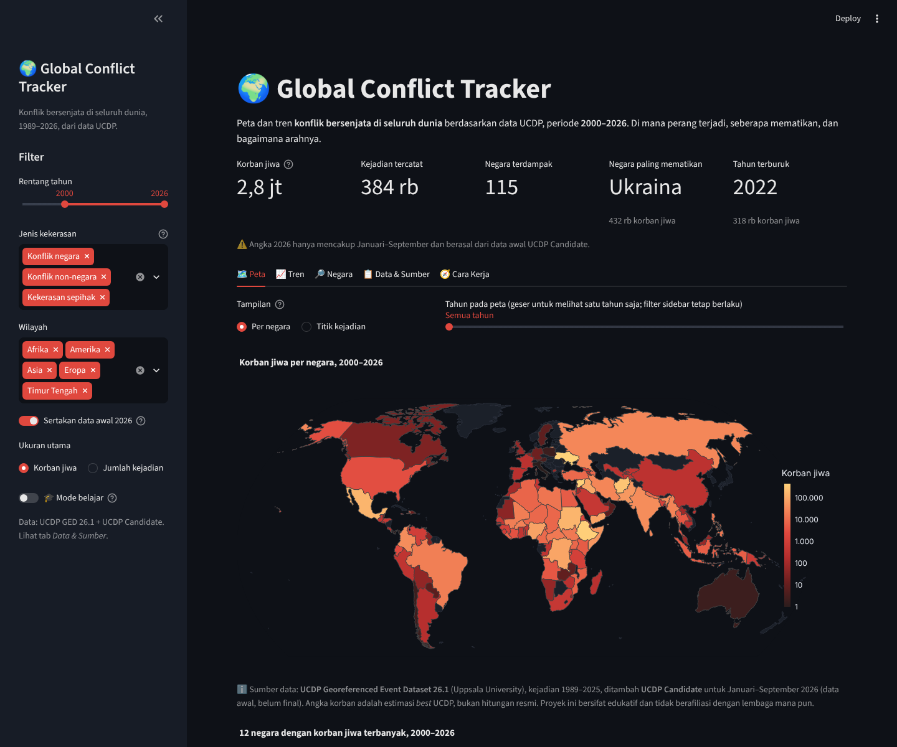
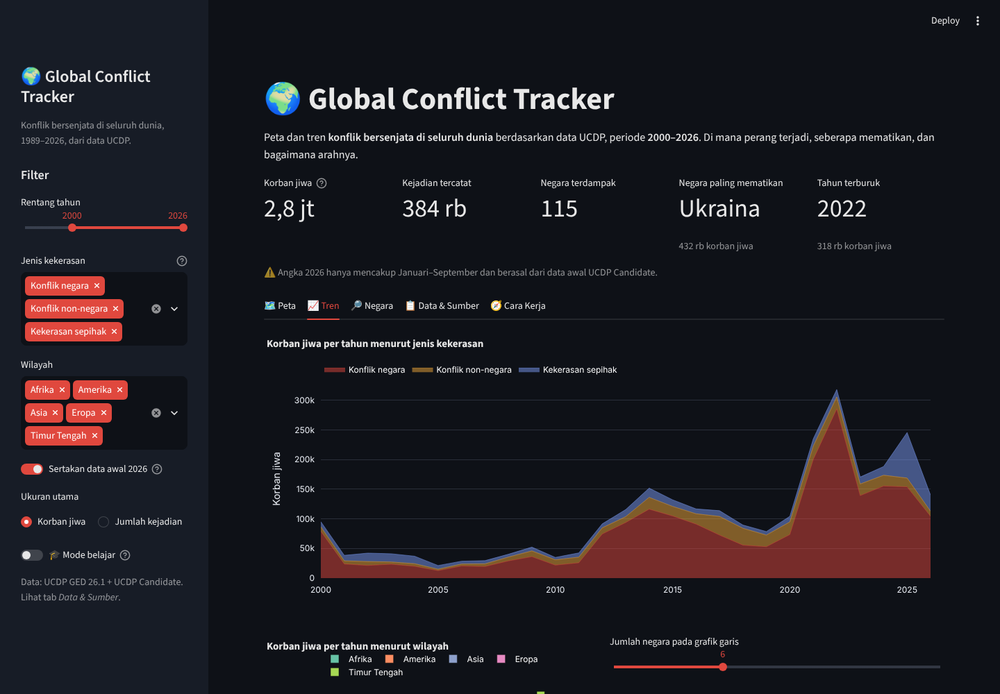
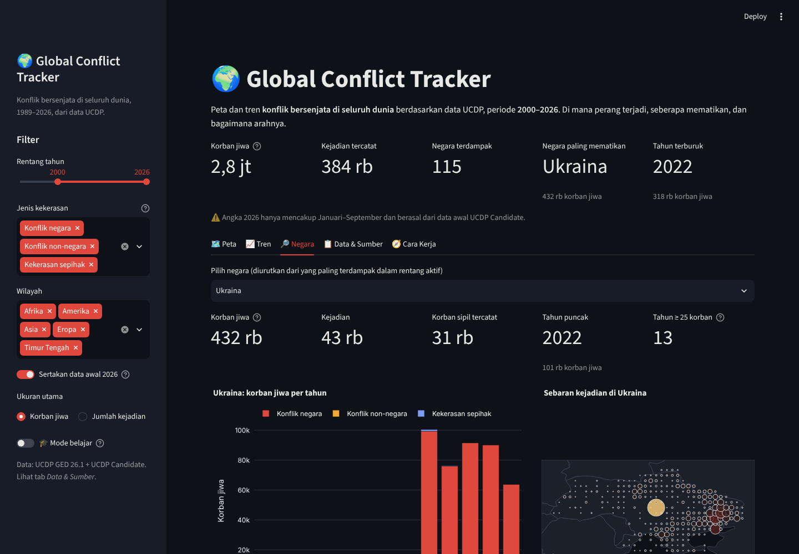
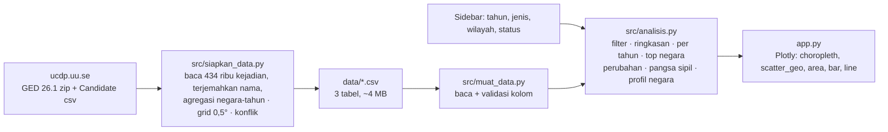

# 🌍 Global Conflict Tracker

[](https://github.com/Avalon2222/global-conflict-tracker/actions/workflows/tests.yml) [](https://www.python.org/) [](LICENSE) [](https://global-conflict-tracker.streamlit.app)

> Peta dan tren **konflik bersenjata di seluruh dunia** 1989–2026: di mana perang terjadi, seberapa mematikan,
> dan ke mana arahnya. Dibangun dengan Python, pandas, Plotly, dan Streamlit di atas data terbuka
> **UCDP Georeferenced Event Dataset**.

*An interactive tracker of armed conflict worldwide, 1989–2026: a choropleth and event map, casualty trends by
type of violence and region, and a per-country drill-down, built on the open UCDP Georeferenced Event Dataset
(417,968 events) plus UCDP Candidate data for 2026. Python, pandas, Plotly, Streamlit.*

**🔴 Live demo:** https://global-conflict-tracker.streamlit.app



> ℹ️ **Disclaimer.** Seluruh angka berasal dari **UCDP** (Uppsala Conflict Data Program), yang dapat diunduh siapa
> saja tanpa registrasi. Korban jiwa adalah estimasi *best* UCDP dari sumber berita dan laporan, bukan hitungan
> resmi, dan hanya mencakup kematian langsung akibat kekerasan. Data 2026 bersifat awal (Januari–September).
> Proyek ini bersifat edukatif dan portofolio pribadi, tidak berafiliasi dengan lembaga mana pun.

## Latar belakang

Berita konflik datang sepotong-sepotong: hari ini Gaza, besok Sudan, lusa Myanmar. Sulit menjawab pertanyaan
sederhana seperti *apakah dunia sekarang lebih berdarah daripada dua puluh tahun lalu?*, *negara mana yang paling
banyak kehilangan nyawa dalam satu dekade terakhir?*, atau *seberapa besar porsi korban sipil?* UCDP telah mencatat
setiap kejadian kekerasan mematikan sejak 1989 dengan koordinat, tanggal, pihak, dan estimasi korban. Proyek ini
mengubah 434 ribu baris data tersebut menjadi peta dan grafik yang dapat dijelajahi, sekaligus menjadi latihan membangun
*pipeline* data: unduh → agregasi → visualisasi → uji.

## Fitur

| Tab | Isi |
|---|---|
| 🗺️ Peta | Choropleth korban/kejadian per negara (skala log) atau peta titik per sel grid 0,5° berwarna menurut jenis kekerasan. Slider tahun untuk melihat satu tahun saja, plus peringkat 12 negara teratas |
| 📈 Tren | Area bertumpuk per jenis kekerasan, batang per wilayah, garis untuk N negara teratas, pita ketidakpastian *low–high*, persentase korban sipil, dan tabel 10 konflik paling mematikan |
| 🔎 Negara | Satu negara: KPI, korban per tahun per jenis dengan garis ambang perang (1.000), peta sebaran kejadian, dan daftar konflik utama (nama UCDP) |
| 📋 Data & Sumber | Tiga tabel agregasi, unduh CSV sesuai filter, tautan sumber, dan daftar keterbatasan data |
| 🧭 Cara Kerja | Alur data, definisi tiga jenis kekerasan UCDP, istilah (*best/low/high*, ambang 25 dan 1.000), dan daftar fungsi inti |
| 🎓 Mode belajar | Toggle di sidebar: setiap tab menampilkan expander berisi penjelasan dan potongan kode di balik grafiknya |

Filter sidebar (rentang tahun, jenis kekerasan, wilayah, data awal 2026, ukuran korban/kejadian) berlaku ke semua tab.




## Cara menjalankan

```bash
git clone https://github.com/Avalon2222/global-conflict-tracker.git
cd global-conflict-tracker
python -m venv .venv && source .venv/bin/activate   # Windows: .venv\Scripts\activate
pip install -r requirements.txt
streamlit run app.py
```

Buka `http://localhost:8501`. Jalankan pengujian dengan `python -m pytest tests/ -v` (21 tes).
Data agregasi sudah tersedia di `data/`, jadi aplikasi dapat langsung dijalankan tanpa koneksi ke UCDP.

### Memperbarui data dari UCDP

```bash
python -m src.siapkan_data            # unduh GED (zip 39 MB) + Candidate, lalu bangun ulang 3 CSV
```

Ketika UCDP merilis versi baru (biasanya setiap Juni) cukup ganti `URL_GED` dan `URL_KANDIDAT` di `src/siapkan_data.py`.
File mentah disimpan di `data/raw/` yang diabaikan git.

## Cara kerja (ringkas)



Logika berada di `src/analisis.py` (pandas murni, tanpa Streamlit, diuji):

| Fungsi | Yang dihitung |
|---|---|
| `filter_data(df, awal, akhir, jenis, wilayah, sertakan_awal)` | Menyaring tabel sesuai sidebar |
| `ringkasan(df)` | Total korban, kejadian, negara terdampak, negara dan tahun terburuk |
| `per_tahun(df, kolom)` | Jumlah per tahun, opsional dipecah per jenis / wilayah / negara |
| `top_negara(df, n, metrik)` | Peringkat negara menurut korban atau kejadian |
| `perubahan_tahunan(df)` | Selisih dan persen perubahan dari tahun sebelumnya |
| `pangsa_sipil(df)` | Persentase korban sipil per tahun |
| `kategori_intensitas(korban)` | Label mengikuti ambang UCDP: < 25, 25–999 (konflik minor), ≥ 1.000 (perang) |
| `profil_negara(negara_tahun, konflik_tahun, negara)` | Semua tabel untuk tab Negara |

## Data

Tiga file CSV di `data/`, seluruhnya diturunkan dari UCDP oleh `src/siapkan_data.py`:

| File | Isi | Baris |
|---|---|---|
| `korban_negara_tahun.csv` | Korban (*best/low/high*), korban sipil, dan kejadian per negara × tahun × jenis kekerasan, 1989–2026 | 4.169 |
| `grid_kejadian.csv` | Kejadian dan korban per sel grid 0,5° × tahun × jenis × negara (untuk peta titik) | 62.580 |
| `konflik_tahun.csv` | Korban per konflik UCDP × tahun, beserta negara utama | 8.983 |

Kolom `status` membedakan `final` (GED 26.1, 1989–2025) dan `awal` (UCDP Candidate, Januari–September 2026).
Definisi, pemetaan nama negara, dan keterbatasan dibahas di [`data/SUMBER_DATA.md`](data/SUMBER_DATA.md).

## Beberapa hal yang terlihat dari data

Pengamatan pribadi dari dashboard dengan filter bawaan (2000–2026, semua jenis):

1. **Dunia memang lebih berdarah sejak 2021.** Setelah relatif tenang pada 2000-an (sekitar 20–50 ribu korban per
   tahun), angka naik tajam oleh Suriah (2012–2016), lalu melonjak ke rekor pasca-1994 pada 2022 (Tigray dan Ukraina,
   lebih dari 300 ribu korban). 2025 kembali di atas 240 ribu.
2. **Beberapa perang mendominasi.** Dalam rentang 2000–2026, Ukraina, Suriah, Etiopia, dan Afganistan menyumbang
   lebih dari separuh korban. Ini terlihat jelas pada grafik garis negara teratas.
3. **Kekerasan sepihak naik lagi pada 2025**, hampir seluruhnya di Sudan (lebih dari 60 ribu korban); porsi korban
   sipil melonjak ke sekitar 37 persen setelah bertahun-tahun di bawah 25 persen.
4. **Meksiko adalah anomali Amerika:** hampir seluruh korbannya tercatat sebagai konflik non-negara antar kartel,
   bukan perang melawan pemerintah.
5. **Pita low–high melebar justru pada tahun terburuk.** Semakin besar perang, semakin tidak pasti hitungannya.

Angka di sini adalah bahan diskusi, bukan kesimpulan: baca dulu daftar keterbatasan di tab Data & Sumber.

## Struktur repositori

```
global-conflict-tracker/
├── app.py                  # tampilan Streamlit (dibaca dari atas ke bawah)
├── src/
│   ├── siapkan_data.py     # ETL: unduh UCDP -> 3 CSV agregasi
│   ├── negara.py           # nama UCDP -> ISO-3 + nama Indonesia
│   ├── muat_data.py        # baca & validasi CSV
│   └── analisis.py         # fungsi analisis murni pandas (diuji)
├── data/                   # 3 CSV + SUMBER_DATA.md (raw/ diabaikan git)
├── tests/test_analisis.py  # 21 tes pytest
├── docs/
│   ├── BELAJAR.md          # panduan belajar bertahap
│   ├── LATIHAN.md          # latihan beserta kunci jawaban
│   └── screenshots/
└── requirements.txt
```

## Belajar dari proyek ini

Mulailah dari [`docs/BELAJAR.md`](docs/BELAJAR.md) (cara membaca data kejadian UCDP, mengapa diagregasi, choropleth
dan skala log, groupby bertingkat), lalu kerjakan [`docs/LATIHAN.md`](docs/LATIHAN.md). Aktifkan **Mode belajar** di
sidebar agar setiap grafik menampilkan kode di baliknya.

## Rencana pengembangan

- [ ] Animasi tahun pada choropleth (`animation_frame`) agar penyebaran konflik terlihat bergerak.
- [ ] Menambahkan populasi (World Bank) untuk korban per 100 ribu penduduk, bukan hanya angka absolut.
- [ ] Menarik UCDP Candidate bulanan secara otomatis lewat GitHub Actions agar data 2026 selalu segar.
- [ ] Lapisan tambahan dari ACLED (memerlukan registrasi gratis) untuk demonstrasi dan kerusuhan tanpa korban jiwa.
- [ ] Halaman per konflik (bukan per negara) dengan garis waktu pihak yang terlibat.

## Lisensi

Kode: MIT. Data: UCDP GED 26.1 dan UCDP Candidate Events Dataset, CC BY 4.0, Uppsala Conflict Data Program.
Sebutkan UCDP jika memakai ulang datanya.
