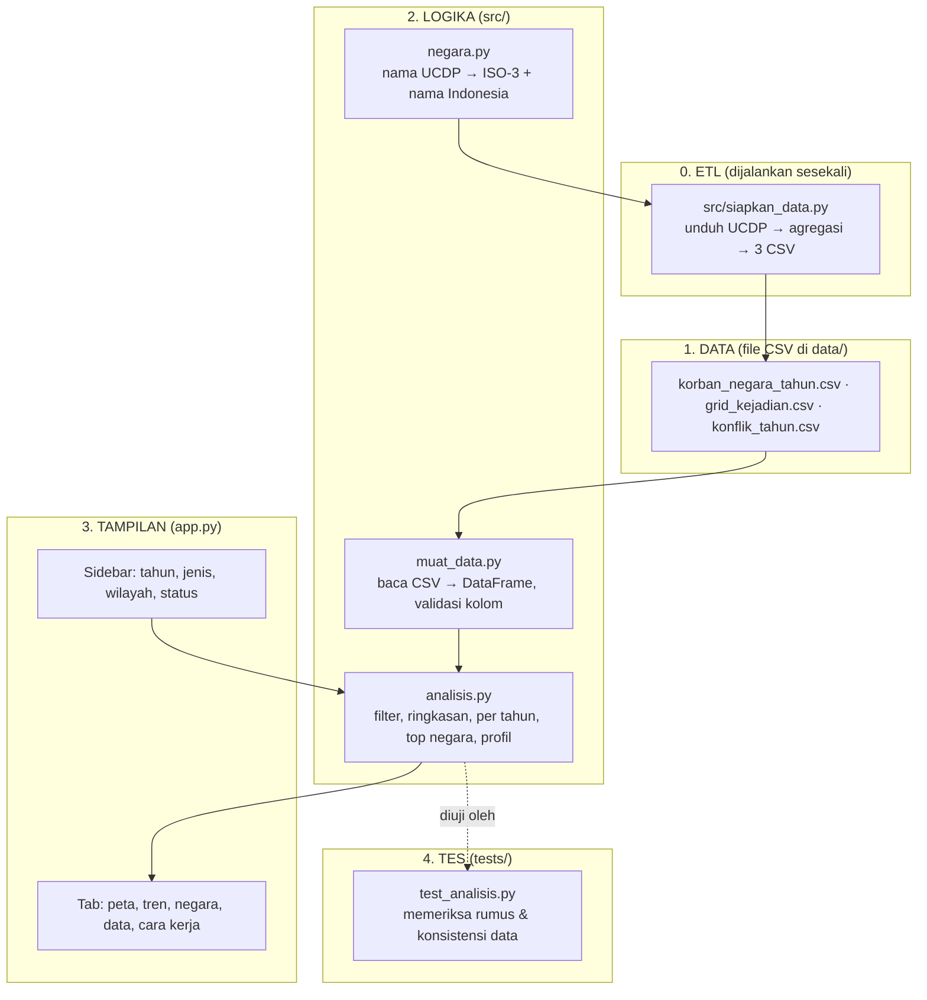

# 🎓 Panduan Belajar: Dari 434 Ribu Baris Data Konflik ke Dashboard

Panduan ini ditujukan bagi pembaca yang sudah mengenal dasar Python tetapi belum pernah membangun dashboard data
dari dataset besar. Tujuannya bukan menghafal kode, melainkan **memahami mengapa kodenya ditulis demikian**. Bacalah
perlahan, buka file yang disebut, dan cobalah mengubah sesuatu di setiap bagian. Jika ada yang rusak,
`git checkout app.py` akan mengembalikannya.

Perkiraan waktu: 3–4 jam, dapat dibagi ke beberapa sesi.

---

## Gambaran besar: 4 lapisan kode



**Mengapa dipisah?**

- Ingin mengganti ke rilis UCDP baru? Jalankan ulang **ETL**, tanpa menyentuh tampilan.
- Ingin menambah grafik? Edit **app.py**, logikanya tidak berubah.
- Ingin memastikan rumus benar? Jalankan **tes**, tanpa membuka browser.

---

## Bagian 1 — Mengenal data UCDP (30 menit)

Unduh satu file kandidat yang kecil (1,6 MB) untuk melihat bentuk aslinya:

```bash
curl -o kandidat.csv https://ucdp.uu.se/downloads/candidateged/GEDEvent_v26_0_9.csv
python -c "import pandas as pd; df=pd.read_csv('kandidat.csv'); print(df.shape); print(df.columns.tolist()); print(df.iloc[0])"
```

Satu baris = satu **kejadian**: tanggal, koordinat, negara, pihak A dan B, nama konflik, serta tiga estimasi korban
(`best`, `low`, `high`) dan `deaths_civilians`. Kolom `type_of_violence` bernilai 1, 2, atau 3.

Pertanyaan untuk dijawab sendiri sebelum lanjut:

1. Berapa kejadian pada file itu, dan berapa jumlah `best`-nya? (`df['best'].sum()`)
2. Negara mana yang paling banyak kejadiannya? (`df['country'].value_counts().head()`)
3. Mengapa `low` ≤ `best` ≤ `high` selalu berlaku? Periksa dengan `(df.low <= df.best).all()`.

> **Catatan metodologi.** UCDP hanya memasukkan kejadian dari konflik yang pernah mencapai 25 korban dalam setahun,
> dan hanya kematian langsung. Ini membuat datanya konsisten antar negara dan tahun, tetapi bukan "jumlah total
> orang yang meninggal karena perang". Baca `data/SUMBER_DATA.md` bagian Keterbatasan.

---

## Bagian 2 — Mengapa data diagregasi dulu (30 menit)

Buka `src/siapkan_data.py`. File GED lengkap berukuran 270 MB; membacanya setiap kali halaman dimuat akan lambat dan
melewati batas memori Streamlit Community Cloud (sekitar 1 GB). Dashboard hanya membutuhkan **jumlah**, jadi kita
hitung sekali dan simpan hasilnya. Pola ini disebut *pre-aggregation*.

Inti skripnya adalah satu `groupby` bertingkat:

```python
g = k.groupby(["negara", "iso3", "wilayah", "tahun", "jenis", "status"], as_index=False).agg(
    kejadian=("korban", "size"),      # jumlah baris
    korban=("korban", "sum"),         # jumlah best
    korban_min=("korban_min", "sum"),
    korban_max=("korban_max", "sum"),
    korban_sipil=("korban_sipil", "sum"),
)
```

Hal yang perlu diperhatikan:

- `as_index=False` membuat kolom kunci tetap menjadi kolom biasa, bukan index, sehingga mudah disaring lagi.
- `("korban", "size")` menghitung jumlah baris; `("korban", "sum")` menjumlahkan nilainya. Keduanya memakai kolom
  yang sama tetapi menghasilkan hal berbeda.
- Kolom `status` ikut menjadi kunci agar data `final` dan `awal` tidak tercampur dan dapat dipisahkan di aplikasi.

**Grid 0,5°.** Untuk peta titik, koordinat dibulatkan: `(lat / 0.5).round() * 0.5`. Angka 7,32 menjadi 7,5; angka
7,18 menjadi 7,0. Semua kejadian dalam kotak yang sama dijumlahkan. Hasilnya 62 ribu baris, bukan 434 ribu, tetapi
polanya di peta dunia tidak berubah. Cobalah mengganti `RESOLUSI_GRID` menjadi `1.0` dan `0.25`, lalu bandingkan
ukuran file dan tampilan petanya.

**Pemetaan nama negara.** Plotly membutuhkan kode ISO-3 untuk choropleth. UCDP memakai nama seperti `DR Congo (Zaire)`.
Tidak ada cara otomatis yang 100 persen benar, jadi `src/negara.py` memetakan 127 nama secara manual. Tes
`test_dataset_bisa_dimuat` memastikan tidak ada negara yang lolos tanpa kode.

---

## Bagian 3 — Logika analisis dan tesnya (45 menit)

Buka `src/analisis.py`. Semua fungsi menerima DataFrame dan mengembalikan DataFrame/dict baru. Tidak ada
`st.` di file ini, sehingga dapat diuji tanpa browser.

### `filter_data`

```python
m = (df["tahun"] >= tahun_awal) & (df["tahun"] <= tahun_akhir)
if jenis:
    m &= df["jenis"].isin(jenis)
if not sertakan_awal:
    m &= df["status"] != "awal"
return df.loc[m].copy()
```

`m` adalah *mask* boolean yang dibangun bertahap dengan `&=`. `.copy()` di akhir menghindari peringatan
`SettingWithCopyWarning` ketika hasilnya diubah belakangan.

### `perubahan_tahunan`

```python
t["selisih"] = t["korban"].diff()
sebelumnya = t["korban"].shift(1)
t["perubahan_pct"] = (t["selisih"] / sebelumnya.where(sebelumnya > 0)) * 100
```

`diff()` mengurangi baris dengan baris sebelumnya; `shift(1)` menggeser satu baris ke bawah. `where(sebelumnya > 0)`
mengganti nol dengan NaN agar tidak terjadi pembagian dengan nol. Tahun pertama otomatis NaN karena tidak punya pembanding.

### `kategori_intensitas`

Ambang 25 dan 1.000 adalah definisi UCDP untuk *konflik aktif* dan *perang*. Fungsi ini sengaja sangat kecil agar
mudah diuji dengan `pytest.mark.parametrize` (lihat `tests/test_analisis.py`): enam kasus batas dalam satu tes.

### Menjalankan dan membaca tes

```bash
python -m pytest tests/ -v
```

Ada dua kelompok tes:

1. **Tes fungsi** memakai `df_kecil`, DataFrame buatan 6 baris yang hasilnya dapat dihitung dengan tangan. Jika kamu
   mengubah rumus dan tes gagal, kamu langsung tahu bagian mana.
2. **Tes data** membaca CSV sungguhan dan memeriksa hal yang *harus* benar: semua negara punya ISO-3, total korban per
   tahun identik di ketiga tabel, dan 1994 (genosida Rwanda) adalah tahun paling mematikan. Tes semacam ini disebut
   *data validation test* dan sangat berguna setelah menjalankan ulang ETL.

---

## Bagian 4 — Tampilan: peta dan grafik (60 menit)

Buka `app.py`. Urutannya selalu sama: konfigurasi → muat data → sidebar → filter → KPI → tab.

### Choropleth dengan skala log

```python
negara_peta["log_nilai"] = np.log10(negara_peta["korban"])
fig = px.choropleth(negara_peta, locations="iso3", color="log_nilai", projection="natural earth")
fig.update_coloraxes(colorbar=dict(tickvals=[0, 1, 2, 3, 4, 5], ticktext=["1", "10", "100", "1.000", "10.000", "100.000"]))
```

Korban per negara membentang dari 1 hingga ratusan ribu. Pada skala linear, satu negara ekstrem membuat semua negara
lain berwarna sama. `log10` memadatkan rentang itu: tiap kenaikan satu satuan berarti sepuluh kali lipat. Supaya
pembaca tidak bingung melihat angka 0–5 di colorbar, `ticktext` menampilkan nilai aslinya.

### Peta titik dengan ukuran yang jujur

```python
sel["ukuran"] = np.sqrt(sel["korban"])
px.scatter_geo(sel, lat="lat", lon="lon", size="ukuran", color="jenis", size_max=30)
```

Mata membandingkan **luas** lingkaran, bukan diameternya. Jika diameter dibuat sebanding dengan korban, titik dengan
korban 4 kali lipat akan tampak 16 kali lebih besar. Akar kuadrat membuat luasnya yang sebanding.

### Grafik area bertumpuk vs garis

Tab Tren memakai `px.area` untuk komposisi per jenis (total + bagian masing-masing), tetapi `px.line` untuk
perbandingan antar negara. Area bertumpuk sulit dibaca untuk lapisan tengah karena garis dasarnya naik turun; garis
terpisah lebih jujur untuk perbandingan.

### Pita ketidakpastian

```python
fig.add_trace(go.Scatter(x=t["tahun"], y=t["korban_max"], line=dict(width=0), showlegend=False))
fig.add_trace(go.Scatter(x=t["tahun"], y=t["korban_min"], fill="tonexty", fillcolor="rgba(224,72,62,0.18)", line=dict(width=0)))
fig.add_trace(go.Scatter(x=t["tahun"], y=t["korban"], line=dict(color="#e0483e", width=2.5)))
```

Pola `fill="tonexty"` mengisi area antara trace ini dan trace **sebelumnya**. Karena itu urutannya penting:
batas atas dulu, baru batas bawah dengan `fill`, lalu garis utama di atas semuanya.

### Caching

```python
@st.cache_data
def ambil_data():
    return muat_data.muat_negara_tahun(), muat_data.muat_grid(), muat_data.muat_konflik()
```

Streamlit menjalankan ulang seluruh `app.py` setiap kali pengguna menggeser slider. Tanpa cache, 4 MB CSV dibaca ulang
setiap interaksi. Dengan `@st.cache_data`, pembacaan hanya terjadi sekali per proses.

---

## Bagian 5 — Eksperimen kecil (30 menit)

Lakukan satu per satu, jalankan ulang aplikasi setelah tiap perubahan:

1. Ubah nilai bawaan slider tahun dari `(2000, TAHUN_MAX)` menjadi `(1989, TAHUN_MAX)`. Perhatikan bagaimana
   Rwanda 1994 mengubah skala semua grafik.
2. Pada choropleth, ganti `color="log_nilai"` menjadi `color="korban"` dan lihat mengapa skala log diperlukan.
3. Pada tab Negara, ganti `n_konflik=8` di `profil_negara` menjadi 15.
4. Tambahkan `animation_frame="tahun"` ke `px.choropleth` (perlu DataFrame per tahun, bukan agregat). Ini adalah
   Latihan 5 di `docs/LATIHAN.md`.

---

## Bacaan lanjutan

- Codebook UCDP GED 26.1: https://ucdp.uu.se/downloads/ged/ged261.pdf
- Dokumentasi Plotly: choropleth (`px.choropleth`), `scatter_geo`, dan `update_geos`
- pandas: *GroupBy: split-apply-combine* dan *Reshaping and pivot tables*
- Streamlit: *Caching* dan *Layouts and containers*
